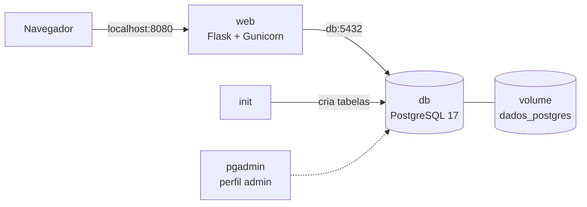
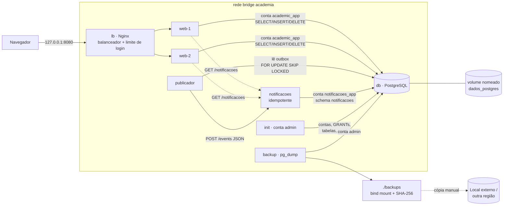
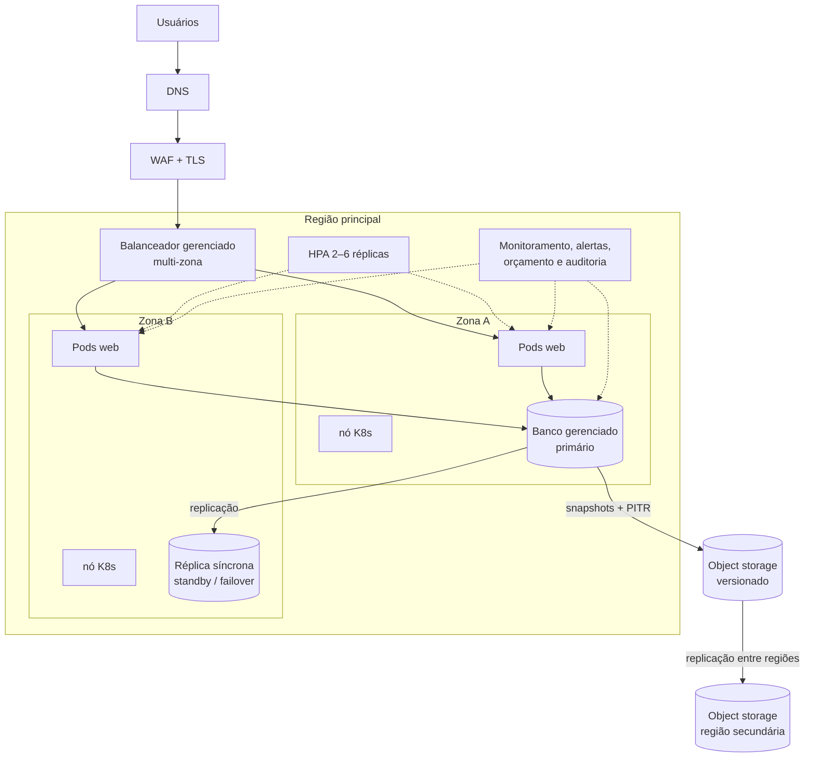

# Arquitetura do AcademiaCloud

## 1. Base original (recebida)


Pontos únicos de falha: `web` (1 instância, porta fixa), `db` e o próprio computador.

## 2. Projeto integrado (implementado e testado)



| Serviço | Imagem | Conta do banco | Publicado no host? |
|---|---|---|---|
| lb | nginx:1.28-alpine | — | sim, `127.0.0.1:${APP_PORT}` |
| web ×2 | academia-cloud:2.0 | `academic_app` | não |
| notificacoes | academia-cloud:2.0 | `notificacoes_app` | não |
| publicador | academia-cloud:2.0 | `academic_app` | não |
| init (one-shot) | academia-cloud:2.0 | `academia_admin` | não |
| backup | postgres:17-alpine | `academia_admin` | não |
| db | postgres:17-alpine | — | não |
| pgadmin (opcional) | dpage/pgadmin4 | — | sim, `127.0.0.1:${PGADMIN_PORT}` |

### Fluxo de uma matrícula (Grupo 2)

```mermaid
sequenceDiagram
  participant S as Secretaria
  participant W as web
  participant D as PostgreSQL
  participant P as publicador
  participant N as notificacoes
  S->>W: POST /api/matriculas
  W->>D: BEGIN; INSERT matriculas; INSERT eventos(pendente); COMMIT
  W-->>S: 201 (não espera a notificação)
  loop a cada 2 s
    P->>D: SELECT eventos pendentes FOR UPDATE SKIP LOCKED
    P->>N: POST /events {evento_id,...}
    alt consumidor OK
      N->>D: INSERT notificacao (evento_id UNIQUE)
      N-->>P: 201 processado / 200 duplicado
      P->>D: UPDATE status = entregue
    else consumidor fora
      P->>D: tentativas+1, próxima tentativa = agora + 2^n s
    end
  end
```

## 3. Proposta de evolução para nuvem (NÃO implementada)



### Por que mais réplicas web não bastam

As réplicas web são *stateless*: a sessão fica em um cookie assinado e todos os dados ficam no PostgreSQL. Se uma réplica cair, a outra continua atendendo. Mas **todas dependem do mesmo banco**. Na demonstração, ao parar o `db`, as duas réplicas passam a responder `503` em `/health/ready`, e o balanceador não consegue esconder isso (veja [GRUPO4_ESCALABILIDADE.md](GRUPO4_ESCALABILIDADE.md)). Para eliminar esse ponto único de falha é preciso um banco com réplica em outra zona e failover, o que é proposta e não faz parte do projeto.

### Volume, replicação e backup são coisas diferentes (Grupo 5)

| Mecanismo | Protege contra | Não protege contra |
|---|---|---|
| Volume nomeado | Remoção ou recriação do container | Perda do disco/host, `down -v`, `DROP TABLE` |
| Replicação | Queda do servidor primário (failover) | Erro lógico: um `DELETE` errado é replicado na hora |
| Backup (pg_dump) | Erro lógico, corrupção, perda do volume | Dados criados depois do último backup (RPO) |
| Cópia externa do backup | Perda do computador/região | Nada, se nunca for testada a restauração |
