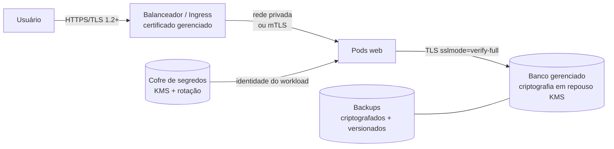

# Grupo 3: Segurança da aplicação e dos recursos de nuvem

**Integrantes:** João Chapichi, João Ep. e Kayky
**Pergunta central:** quem pode acessar cada recurso, e quais responsabilidades pertencem à instituição e quais ao provedor?

## 1. Riscos encontrados na base original

| # | Risco na base | Pilar CIA | Correção aplicada |
|---|---|---|---|
| R1 | Sem login: qualquer pessoa na rede local cadastra e exclui dados | C, I | Login com sessão e autorização por perfil |
| R2 | A aplicação usava a conta criada por `POSTGRES_USER`, que é **superusuário** | C, I, D | Conta `academic_app` só com DML; conta administrativa usada apenas por `init` e `backup` |
| R3 | Senha do banco dentro de `DATABASE_URL`, visível em `docker inspect` | C | Docker secrets em `/run/secrets`, sem senha em variável de ambiente |
| R4 | Senhas com símbolos quebravam a URL | D | URL montada com `URL.create`, que codifica qualquer caractere |
| R5 | Sem registro de quem fez o quê | I | Tabela `auditoria` com login, ação, recurso, resultado, IP e instância |
| R6 | Login sem limite de tentativas | C | Bloqueio após 5 falhas em 5 minutos por usuário (no banco, vale para todas as réplicas) e limite de 10 por minuto por IP no Nginx |
| R7 | Requisições forjadas por outro site (CSRF) | I | Cookie `SameSite=Strict` + `HttpOnly` e exigência de `Content-Type: application/json` |
| R8 | Dados pessoais expostos a todos | C | Professor vê e-mails mascarados (`a***@example.test`), por minimização de dados (LGPD) |
| R9 | Serviço de notificações poderia ler tabelas acadêmicas | C | Conta própria `notificacoes_app`, só com acesso ao schema `notificacoes` |

**Já estava correto na base:** o container rodava como não root (uid 10001), as portas eram publicadas só em `127.0.0.1`, o SQL era parametrizado e havia CSP.

## 2. Três camadas de controle de acesso (não confundir)

| Camada | Quem controla | Exemplo neste projeto | Exemplo em nuvem |
|---|---|---|---|
| **IAM do provedor** | Quem administra a infraestrutura | (não há nuvem contratada) | Política que permite só ao time de operação criar VMs ou ler o cofre de segredos, com MFA obrigatório |
| **Permissões do banco** | Quais comandos SQL cada conta pode executar | `academic_app` não pode `DROP` nem `UPDATE usuarios` | Mesma ideia no banco gerenciado, mais autenticação IAM no banco |
| **Autorização da aplicação** | Quais telas e ações cada pessoa pode usar | A secretaria não cadastra disciplinas | Igual, com SSO/MFA na entrada |

## 3. Matriz de acesso da aplicação

| Recurso / ação | administrador | secretaria | professor | sem login |
|---|:-:|:-:|:-:|:-:|
| Ver resumo (contadores) | ✅ | ✅ | ✅ | ✅ |
| Listar alunos | ✅ | ✅ | ✅ (e-mail mascarado) | ❌ 401 |
| Cadastrar ou excluir aluno | ✅ | ✅ | ❌ 403 | ❌ |
| Listar disciplinas e matrículas | ✅ | ✅ | ✅ | ❌ |
| Cadastrar ou excluir disciplina | ✅ | ❌ 403 | ✅ | ❌ |
| Criar ou cancelar matrícula | ✅ | ✅ | ❌ 403 | ❌ |
| Eventos, notificações, auditoria | ✅ | ❌ 403 | ❌ 403 | ❌ |

Toda negação (403) é gravada na auditoria como `acesso_negado`. A matriz está em `PODE_ESCREVER`, em [app/main.py](../app/main.py).

## 4. Matriz de acesso do banco (menor privilégio)

| Conta | Usada por | Permissões |
|---|---|---|
| `academia_admin` | `init`, `backup` | Superusuário: só para DDL e backup |
| `academic_app` | `web`, `publicador` | `SELECT/INSERT/DELETE` em alunos, disciplinas e matrículas; `SELECT/INSERT/UPDATE` em eventos; `SELECT` em usuarios; `SELECT/INSERT` em auditoria. **Nenhum** DDL e nenhum acesso ao schema `notificacoes` |
| `notificacoes_app` | `notificacoes` | `SELECT/INSERT` em `notificacoes.notificacoes` e nada mais |
| `PUBLIC` | — | `REVOKE ALL ON DATABASE` e sem `CREATE` em `public` |

Os GRANTs ficam em [app/init_db.py](../app/init_db.py). O `init` é idempotente e reaplica as permissões a cada subida, inclusive depois de uma restauração.

## 5. Demonstração

```sh
bash scripts/demo-seguranca.sh
```

Saída real obtida em 05/11/2026 (trechos):
```
$ docker compose exec web id
uid=10001(academic) gid=10001(academic) groups=10001(academic)

$ docker compose exec web ls -l /run/secrets
-r--r--r--. 1 root root 24 Nov  5 17:43 app_db_password
-r--r--r--. 1 root root 48 Nov  5 17:43 secret_key
$ docker compose exec web env | grep -i pass
DB_PASSWORD_FILE=/run/secrets/app_db_password        <- só o caminho, nunca a senha

$ DROP TABLE alunos                                   (como academic_app)
ERROR:  must be owner of table alunos
$ UPDATE usuarios SET perfil='administrador'
ERROR:  permission denied for table usuarios
$ SELECT * FROM notificacoes.notificacoes
ERROR:  permission denied for schema notificacoes
$ SELECT count(*) FROM alunos                         (como notificacoes_app)
ERROR:  permission denied for table alunos

GET /api/alunos sem login        -> HTTP 401
professor: POST /api/alunos      -> HTTP 403
professor: GET /api/alunos       -> [{"email":"a***@example.test",...
tentativas 1–5 de login errado   -> HTTP 401 ;  tentativa 6 -> HTTP 429

X-Content-Type-Options: nosniff
X-Frame-Options: DENY
Referrer-Policy: no-referrer
Content-Security-Policy: default-src 'self'; ... frame-ancestors 'none'
```

PowerShell (sem o script):
```powershell
docker compose exec web id
docker compose exec web ls -l /run/secrets
docker compose exec db psql -h localhost -U academic_app -d academia -c "DROP TABLE alunos"
curl.exe -i http://localhost:8080/api/alunos
```

## 6. Outras medidas aplicadas

- **Senhas com hash scrypt** (Werkzeug). A tabela `usuarios` nunca guarda a senha em texto.
- **Sessão sem estado no servidor:** cookie assinado com `SECRET_KEY`, válido por 8 horas e igual em todas as réplicas. Funciona com o balanceador sem *sticky session*.
- **`no-new-privileges`** em todos os containers da aplicação (verificado: `NoNewPrivs: 1`).
- **Logs sem segredos:** os logs registram usuário, rota, status e instância, mas nunca o corpo da requisição nem a senha.
- **`scripts/gerar-env.sh`** gera senhas aleatórias e grava o `.env` com permissão `600`.
- **Cabeçalhos:** CSP, `X-Frame-Options: DENY`, `nosniff`, `Referrer-Policy` e `Cache-Control: no-store` na API. O Nginx usa `server_tokens off`.
- **CSP e frontend React:** `script-src 'self'` (nenhum script inline ou externo). Em `style-src` foi preciso liberar `'unsafe-inline'`, porque os componentes Radix e o Sonner (shadcn/ui) injetam `<style>` em tempo de execução. É uma troca consciente: estilo inline não executa código, e o risco principal (XSS por script) continua bloqueado. O React também escapa todo texto exibido.
- **Rotas protegidas no frontend** (redireciona para `/login` e esconde menus por perfil) são **conveniência de interface**. A proteção real é a API, que responde 401/403. Teste: o professor abre `/admin/auditoria` e vê "Acesso negado", e a chamada à API também retorna 403.

**Teste que não funcionou (registrado):** `read_only: true` no Compose falhou com `cannot create secret ... in read-only service: 'file' is the sole supported option`. Secrets do tipo `environment` são copiados para dentro do container. A alternativa seria usar secrets do tipo `file`. Nos manifests Kubernetes, o `readOnlyRootFilesystem: true` está configurado.

## 7. Criptografia e secrets na nuvem (proposta)



- **Em trânsito:** HTTPS no Ingress (veja [k8s/04-web.yaml](../k8s/04-web.yaml)) e TLS entre a aplicação e o banco. Com HTTPS, use `COOKIE_SECURE=true`.
- **Em repouso:** discos, banco e backups criptografados com chaves do KMS do provedor.
- **Secrets:** um cofre substitui o `.env`. O acesso é dado pela identidade do workload (sem senha em arquivo), com rotação periódica.
- **IAM:** contas individuais, MFA obrigatório, papéis por função (operação, desenvolvimento, auditoria) e revisão periódica.

## 8. Responsabilidade compartilhada

| Item | Instituição | Provedor |
|---|---|---|
| Segurança física, hardware, hipervisor | | ✅ |
| Rede global, disponibilidade da região | | ✅ |
| Patches do banco gerenciado | | ✅ |
| Configuração do IAM, MFA, quem acessa | ✅ | |
| Código da aplicação, perfis e validações | ✅ | |
| Atualizar imagens e dependências | ✅ | |
| Classificar e proteger dados pessoais (LGPD) | ✅ | |
| Ativar criptografia, backups, logs | ✅ (configura) | ✅ (oferece) |

## 9. Limitações

- Não há HTTPS local nem MFA.
- O bloqueio de força bruta é por usuário e, por isso, pode ser usado para travar a conta de outra pessoa durante 5 minutos (é um risco aceito no laboratório).
- Uma sessão continua válida até expirar, mesmo que o usuário seja desativado (seria preciso uma lista de revogação).
- Não há varredura automática de vulnerabilidades. Sugestão: `docker scout cves academia-cloud:2.0` ou Trivy no CI.

**Ligação com outros grupos:** a conta de menor privilégio é usada pelo outbox (G2); a sessão sem estado viabiliza as réplicas (G4); o backup usa a conta administrativa e fica fora do volume (G5); a auditoria alimenta a governança (G6).

## Referências
- Docker. *Manage secrets securely in Docker Compose*. https://docs.docker.com/compose/how-tos/use-secrets/
- PostgreSQL 17. *GRANT* e *Privileges*. https://www.postgresql.org/docs/17/sql-grant.html
- OWASP. *Cross-Site Request Forgery Prevention Cheat Sheet*. https://cheatsheetseries.owasp.org/cheatsheets/Cross-Site_Request_Forgery_Prevention_Cheat_Sheet.html
- OWASP. *Authentication Cheat Sheet*. https://cheatsheetseries.owasp.org/cheatsheets/Authentication_Cheat_Sheet.html
- Lei nº 13.709/2018 (LGPD), art. 6º (necessidade) e art. 46 (segurança). https://www.planalto.gov.br/ccivil_03/_ato2015-2018/2018/lei/l13709.htm
