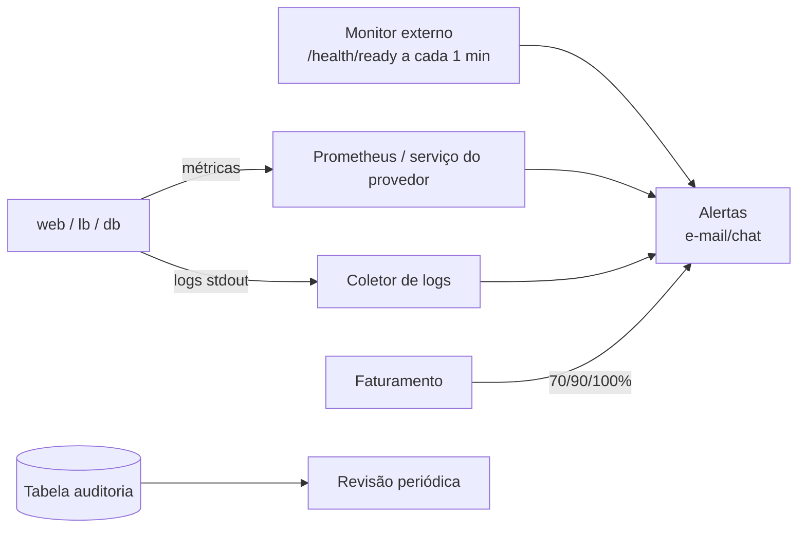

# Grupo 6: Diagnóstico, custos e governança

**Integrantes:** João Neves, Karen e Giovani
**Pergunta central:** como saber se o serviço está saudável, quanto ele custa e se atende às regras da instituição?

Este documento segue `AcademiaCloud_Grupo6_Para_Integracao.md`.

## 1. Diagnóstico

```sh
bash scripts/diagnostico.sh        # salva em evidencias/diagnostico_<data>.txt
```
Saída real (05/11/2026, trechos):
```
Consumo de CPU e memória (docker stats --no-stream)
academia-cloud-lb-1            0.00%   10.04MiB / 64MiB    15.69%
academia-cloud-notificacoes-1  19.44%  68.57MiB / 128MiB   53.57%
academia-cloud-publicador-1     4.49%  36.96MiB / 128MiB   28.88%
academia-cloud-web-1           27.68%  98MiB / 256MiB      38.28%
academia-cloud-web-2            0.01%  97.52MiB / 256MiB   38.10%

Saúde: /lb/health 200 · /health/live 200 · /health/ready 200

POST /api/alunos {}  ->  {"erro":"Nome deve ter de 2 a 100 caracteres."}  HTTP 400
web-2 | INFO method=POST path=/api/alunos status=400 duration_ms=0.2 instance=8445479e48ff user=admin

Fila de eventos (outbox): {'entregue': 2}

Últimos erros/avisos:
lb-1 | [error] no live upstreams while connecting to upstream ... GET /health/ready
```
**Um problema real foi encontrado pelo diagnóstico:** o erro `no live upstreams` aparecia porque o `lb` subia antes das réplicas ficarem prontas. **Causa:** `depends_on: web: service_started`. **Correção:** mudar para `service_healthy` em [compose.yaml](../compose.yaml). **Impacto:** alguns segundos de 502 logo após `up`.

**Falha controlada do banco** (também está em `demo-balanceamento.sh`):
```sh
docker compose stop db
curl -i http://localhost:8080/health/ready     # 503 {"banco":"desconectado"}
docker compose logs --tail=30 web
docker compose start db
curl -i http://localhost:8080/health/ready     # 200 depois de alguns segundos
```

Outros comandos: `docker compose logs -f web`, `docker inspect <container>`, `docker compose exec web id`.

**Logs × métricas × healthcheck:** os logs são eventos individuais ("POST status=400"). As métricas são números no tempo (CPU de 27%). O healthcheck responde a uma pergunta binária ("consegue atender?"). Nenhum deles sozinho é monitoramento: falta histórico, painel e alerta (veja a proposta abaixo).

## 2. O que foi implementado para operação

| Item | Onde |
|---|---|
| Limites de CPU e memória por serviço (dimensionamento) | `deploy.resources.limits` em [compose.yaml](../compose.yaml) |
| Retenção de logs: 10 MB × 3 arquivos por container | `logging.options` em [compose.yaml](../compose.yaml) |
| Logs com método, rota, status, duração, instância e usuário | [app/main.py](../app/main.py) |
| Log do balanceador com o upstream e o tempo | `log_format balanceador` em [infra/nginx/default.conf](../infra/nginx/default.conf) |
| Trilha de auditoria (login, criação, exclusão, negações) | Tabela `auditoria` e `GET /api/auditoria` (admin) |
| Coleta de evidências | [scripts/diagnostico.sh](../scripts/diagnostico.sh) |

## 3. Custos (modelo para preencher)

> Os valores **não** foram preenchidos de propósito: preços inventados seriam incorretos. Preencha consultando a calculadora oficial do provedor e registrando a data e o link.

Premissas da arquitetura integrada (o que precisa ser cotado):

| Item | Cenário econômico | Cenário com maior disponibilidade |
|---|---|---|
| Computação | 1 VM pequena (2 vCPU, 4 GB) rodando o Compose inteiro | Cluster K8s gerenciado: 2 nós em 2 zonas (2 vCPU, 4 GB cada) |
| Banco | PostgreSQL no próprio container (disco da VM) | PostgreSQL gerenciado, Multi-AZ (primário + standby) |
| Armazenamento | Disco de 30 GB | Discos dos nós + armazenamento do banco (20 GB) |
| Backup | `pg_dump` diário, 14 cópias, enviado para object storage (~1 GB) | Snapshots automáticos + PITR 7 dias + cópia para outra região |
| Rede | IP público, sem balanceador gerenciado | Balanceador gerenciado + tráfego de saída |
| Monitoramento | Logs locais | Serviço de métricas, logs e alertas do provedor |
| Disponibilidade esperada | Uma VM em uma zona: ponto único | Tolera a queda de um nó ou de uma zona |

Tabela de cotação:

| Item | Provedor / região / moeda | Configuração | Horas/mês | Preço unitário | Fonte (link) + data | Custo mensal |
|---|---|---|---|---|---|---|
| ... | ex.: AWS / sa-east-1 / USD | | 730 | | | |
| **Total** | | | | | | |
| Não incluído | impostos, tráfego excedente, suporte | | | | | |

Fontes oficiais para consulta: AWS Pricing Calculator (https://calculator.aws/), Azure Pricing Calculator (https://azure.microsoft.com/pricing/calculator/), Google Cloud Pricing Calculator (https://cloud.google.com/products/calculator).

**Práticas FinOps:**
- Os limites de CPU e memória do Compose são o ponto de partida para escolher o tamanho da VM. No diagnóstico, as réplicas web usaram cerca de 98 MiB de 256 MiB.
- Orçamento mensal com alertas em 70%, 90% e 100% (valores didáticos). **O alerta não bloqueia a cobrança.**
- Tags em todo recurso: `projeto=academiacloud`, `ambiente=lab|prod`, `responsavel=<nome>`.
- Desligar ambientes de laboratório (ex.: `docker compose -p academia-lab down -v` depois do teste de restauração).
- Revisão mensal de recursos ociosos e da retenção de backups (mais cópias significa mais custo de armazenamento).

## 4. Governança

**SLA × SLO:** o SLA é o contrato do **provedor** para um serviço específico (por exemplo, a VM). A disponibilidade do AcademiaCloud depende de todos os componentes juntos (VM, banco, aplicação, rede e deploys) e pode ser menor que o SLA de qualquer um deles.

**SLO proposto (didático, não contratado):** 99,5% de respostas 200 em `/health/ready`, medidas a cada minuto por um monitor externo, em uma janela de 30 dias. Isso permite cerca de 3,6 h de indisponibilidade por mês.

| Tema | Regra proposta | Situação no projeto |
|---|---|---|
| Acessos | Contas individuais, perfis, menor privilégio, revisão trimestral | ✅ 3 perfis + contas do banco separadas (G3). ⚠️ Sem tela de gestão de usuários |
| Credenciais | Fora de repositórios, logs e prints | ✅ Docker secrets, `.env` no `.gitignore`, logs sem corpo de requisição |
| Auditoria | Data, responsável, ação, recurso, resultado | ✅ Tabela `auditoria` |
| Logs | Retenção definida conforme a finalidade, com acesso restrito | ✅ 30 MB por container (rotação). ⚠️ Sem centralização |
| Backup | Acesso restrito, retenção, local separado, teste de restauração | ✅ 14 cópias + teste (G5). ⚠️ Cópia externa manual |
| Incidentes | Registrar serviço, horário, impacto, ação e responsável | 📝 Modelo abaixo |
| Custos | Orçamento, alertas, responsável | 📝 Proposta |
| Dados pessoais | Minimização, finalidade, segurança | ✅ E-mail mascarado para o professor; somente dados fictícios |

**Modelo de registro de incidente:**
```
Data/hora início–fim:  | Serviço afetado:  | Impacto (usuários/funções):
Detecção (como):       | Causa:            | Ação de recuperação:
Responsável:           | Lições/ações preventivas:
```

**LGPD:** o AcademiaCloud trataria dados pessoais (nome e e-mail de alunos). Princípios aplicados: **necessidade** (art. 6º, III), com o e-mail mascarado para quem não precisa dele, e **segurança** (art. 6º, VII, e art. 46), com controle de acesso, auditoria e backups protegidos. Os prazos de retenção devem seguir a finalidade, e não um número universal. Consulte as orientações da ANPD.

## 5. Monitoramento proposto (não implementado)



## Referências
- Docker. *docker container logs*. https://docs.docker.com/reference/cli/docker/container/logs/
- Docker. *docker container stats*. https://docs.docker.com/reference/cli/docker/container/stats/
- Docker. *JSON File logging driver*. https://docs.docker.com/engine/logging/drivers/json-file/
- Lei nº 13.709/2018 (LGPD). https://www.planalto.gov.br/ccivil_03/_ato2015-2018/2018/lei/l13709.htm
- ANPD. https://www.gov.br/anpd/pt-br
- FinOps Foundation. *FinOps Framework*. https://www.finops.org/framework/
